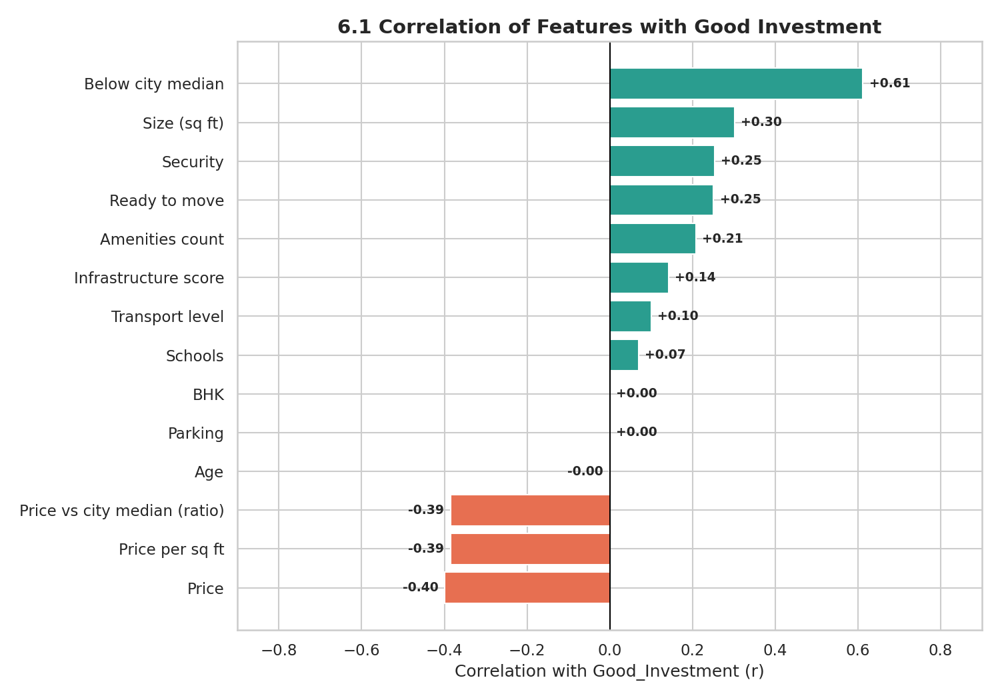
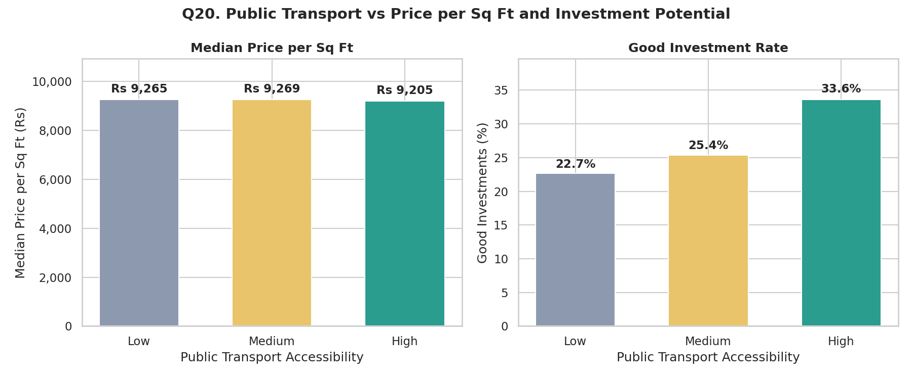

<p align="center">
  
</p>

<h1 align="center">SqFt Signal — Real Estate Investment Advisor</h1>

<p align="center">
  <b>Cut through the noise. Find the deals that matter.</b><br>
  Is this property a good investment, and what will it be worth in 5 years?
</p>

<p align="center">
  <a href="https://sqft-signal.streamlit.app"></a>
  <a href="https://colab.research.google.com/github/Vipsa2207/Real-Estate-Investment-Advisor/blob/main/notebooks/Real_Estate_Investment_Advisor.ipynb"></a>
  
  
</p>

---

## 📌 Live App

**👉 [sqft-signal.streamlit.app](https://sqft-signal.streamlit.app)**
**📄 [Full project documentation (PDF)](docs/SqFt_Signal_Project_Documentation.pdf)**

> If the app shows a *"This app has gone to sleep"* message, click **"Yes, get this app back up!"** and wait about 30 seconds. Free Streamlit apps sleep when unused.

---

## 🎯 Business Problem

Property investors in India face thousands of listings and very little clarity. Two questions matter most:

1. **Is this property a Good Investment?**
2. **What will it be worth after 5 years?**

**SqFt Signal** answers both with a transparent, data-backed rule and a 5-year value estimate, built on an analysis of **250,000 listings across 20 states and 42 cities**.

This project was completed as **Labmentix Project 7** (Business / Data Analyst internship).

---

## 💡 Key Findings

| # | Finding | Evidence |
|---|---|---|
| 1 | **No property feature drives price** | 88 of 91 numeric feature pairs show no correlation; size vs price r = −0.003 |
| 2 | **Location barely matters** | States differ by 2.5%, cities by 3.1% in price; Mumbai and Delhi are among the cheapest cities |
| 3 | **Price per sq ft vs the city median is the real value signal** | It varies 3.3× within cities and is the strongest driver of a Good Investment (r = +0.61) |
| 4 | **Quality comes free** | Amenities, schools, hospitals, transport, parking, furnishing and facing add no more than 0.5–2.4% to price |
| 5 | **Large homes give the most space per rupee** | 40.1% of large homes qualify as Good Investments vs 8.9% of small homes |
| 6 | **No under-construction discount** | Prices differ by only 0.3%, so ready-to-move homes are better value |
| 7 | **7.9% of listings are overpriced outliers** | 19,724 properties above ₹32,763/sq ft — small homes (median 799 sq ft) at high prices |

> ⚠️ **The dataset is synthetic.** Values are spread evenly and features do not influence price, unlike a real market. All findings are reported honestly with this in mind.

---

## 🧮 The Good Investment Rule

A property is a **Good Investment** if it passes the **must-have** test **and** meets **at least 2 of 4** quality criteria.

| Criterion | Rule | Share passing |
|---|---|---|
| 💰 **Value (must-have)** | Price per sq ft below its city median | 50.0% |
| 🏠 Ready to move | Availability = Ready to Move | 50.0% |
| 🚇 Strong infrastructure | Infrastructure Score ≥ 6.5 (top ~25%) | 23.7% |
| 🏊 Amenity-rich | 4 or more amenities | 40.1% |
| 🔒 Security | Security available | 50.1% |

**Result:** 68,122 properties (**27.2%**) qualify; 3,006 (**1.2%**) score a perfect 5/5.

**Infrastructure Score (0–10)** = equal-weight average of nearby schools, nearby hospitals and public transport, each scaled to 0–1.

**Future value:** `Future_Price_5Y = Price × (1.05)^5` → **+27.63%** over 5 years (5% annual growth assumption).

---

## 🖥️ App Features

| Tab | What it does |
|---|---|
| **Sidebar filters** | State → City (linked), property type, BHK, price and size ranges, live match counter, reset button |
| **KPI cards** | Properties, median ₹/sq ft, average price, Good Investment %, average 5-year value — each compared with the whole market |
| 📊 **Market Pulse** | Four interactive charts that update with the filters |
| 🔍 **Insight Explorer** | Step through all 20 EDA questions + 2 correlation analyses, each with its chart and insight |
| 🧮 **Investment Checker** | Enter any property → verdict, Deal Score gauge, value meter vs city median, ✅/❌ reasons, year-by-year 5-year value, downloadable report |
| 🏆 **Top Picks** | Best Good Investments in the filtered market, shown as cards |
| 💡 **Recommendations** | Evidence-backed advice for investors and real-estate platforms, plus a data reality check |

---

## 🔬 Methodology

| Phase | Work done |
|---|---|
| 1. Understand | Checked types, ranges, unique values, category labels and location structure |
| 2. Clean | 0 missing values, 0 duplicates; fixed 116,304 impossible floor values (46.5%) by swapping and flagging them |
| 3. Preprocess | Yes/No → 1/0 flags; category types; ordered Low < Medium < High and Unfurnished < Semi < Furnished (−35% memory) |
| 4. Feature engineering | Price per sq ft in ₹, amenity count + flags, Infrastructure Score, floor position, price vs city median, 5-year future price, Good Investment label, helper bands |
| 5. EDA | 20 business questions, one chart each, with insight, implication and action |
| 6. Correlation | Feature heatmap, drivers of Good Investment, size vs return and infrastructure vs resale value |
| 7. Save | `india_housing_cleaned.csv` (250,000 rows × 49 columns) |
| 8. App | Streamlit app deployed on Streamlit Community Cloud |

---

## 📊 Sample Visuals

<p align="center">
  
  
</p>

All 22 charts are in [`assets/charts`](assets/charts).

---

## 📁 Project Structure

```
Real-Estate-Investment-Advisor/
├── app.py                      # Streamlit app (SqFt Signal)
├── insights.py                 # Insight Explorer text + recommendations
├── requirements.txt            # Libraries for Streamlit Cloud
├── .streamlit/config.toml      # App theme (navy / teal)
├── notebooks/
│   └── Real_Estate_Investment_Advisor.ipynb   # Full analysis (Colab)
├── data/
│   ├── india_housing_prices.zip               # Raw data (zipped)
│   └── india_housing_cleaned.csv.gz           # Cleaned data used by the app
└── assets/
    ├── logo.png, logo_original.png
    └── charts/                                # 22 EDA and correlation charts
```

---

## ⚙️ Run Locally

```bash
git clone https://github.com/Vipsa2207/Real-Estate-Investment-Advisor.git
cd Real-Estate-Investment-Advisor
pip install -r requirements.txt
streamlit run app.py
```

The notebook runs end-to-end in Google Colab with **Runtime → Run all** — the data loads directly from this repository, so no upload or Google Drive access is needed.

---

## 🛠️ Tech Stack

**Python** · **pandas** · **NumPy** · **Matplotlib** · **Seaborn** · **Plotly** · **Streamlit** · **Google Colab** · **Git / GitHub** · **Streamlit Community Cloud**

---

## ⚠️ Limitations

- The dataset is **synthetic**; patterns do not reflect the real Indian property market.
- **Good Investment** is a transparent **rule-based** label, not an observed market outcome.
- **Future value** uses one fixed 5% growth rate for every property.
- No sale dates (so no true price trends) and no crime-rate data.
- Locality names are codes reused across all 42 cities.
- Results demonstrate the method and are **not financial advice**.

**Possible next steps:** location- and type-specific growth rates from real historical prices, RERA and crime data, and ML models (Random Forest / XGBoost with MLflow tracking) once real outcome data is available.

---

## 👩‍💻 Author

**Vipsa** — B.Tech CSE (Data Science), ITM Vocational University, Vadodara
Labmentix Internship · Business / Data Analyst

[GitHub](https://github.com/Vipsa2207) · [LinkedIn](https://linkedin.com/in/vipsapatel)
